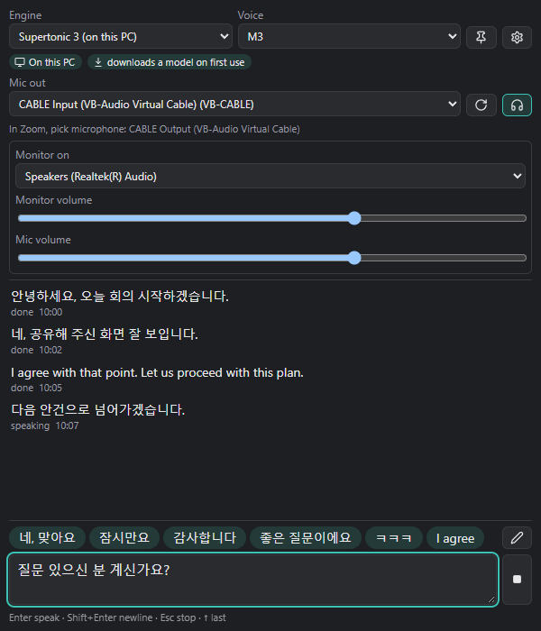
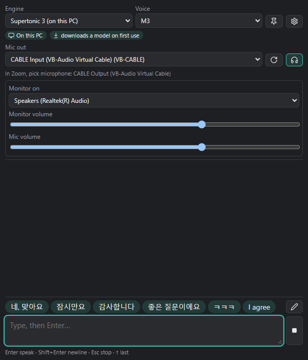

# Soritong (소리통)

Type in Korean or English and have it spoken directly through your microphone in Zoom, Google Meet, Microsoft Teams, or Discord.



---

## Overview

Soritong is a lightweight Windows desktop application designed for people who need or prefer to participate in voice and video calls without speaking aloud. Whether managing vocal fatigue, working in a shared or quiet office, recovering from illness, or desiring speech assistance, Soritong lets you type naturally and speak instantly.

- **Direct Microphone Output**: Spoken audio is routed directly into your virtual microphone, so meeting participants hear clean speech without background noise.
- **Simultaneous Monitoring**: Optionally hear everything you speak in your headphones so you always know what was heard.
- **Bilingual Support**: Fluent text-to-speech for both Korean and English.
- **Offline and Cloud Engines**: Choose between completely private offline models running on your GPU or high-fidelity cloud voices.

---

## How It Works

```
+-----------------------------------------------------------+
|                        Soritong                           |
|  [ Type text in Korean / English ] ---> [ TTS Engine ]    |
+-----------------------------------------------------------+
                               |
                               v
                     [ VB-CABLE Input ]
                               |
              +----------------+----------------+
              |                                 |
              v                                 v
      [ Meeting Apps ]                   [ Headphones ]
   Zoom / Meet / Discord                Local Monitor
 (Microphone: CABLE Output)           (Hear what is said)
```

1. You type a sentence and press **Enter**.
2. Soritong synthesizes the speech and plays it into a virtual audio cable (VB-CABLE).
3. In Zoom or Google Meet, set your microphone to **CABLE Output (VB-Audio Virtual Cable)**.
4. Meeting participants hear your typed words as clear spoken audio.

---

## Setup Wizard

When you first open Soritong, the built-in Setup Wizard guides you through configuring your audio devices:



The wizard can:
- Automatically download and launch the VB-CABLE installer with a single click.
- Restore your default speakers and microphone so normal sound is not disturbed.
- Run an audio loopback check to verify that speech reaches the microphone before joining a call.
- Provide step-by-step instructions for selecting the microphone in Zoom.

You can reopen the setup wizard at any time from the app settings.

---

## TTS Engines

Soritong supports five speech engines:

| Engine | Type | Privacy & Requirements |
| :--- | :--- | :--- |
| **Supertonic 3** | Local Offline | Runs entirely on your local PC via DirectML GPU acceleration. No internet connection, no API keys, complete privacy. |
| **Edge Online** | Cloud (Free) | Natural Korean and English voices from Microsoft Edge. Fast, free, and does not require an API key. |
| **ElevenLabs** | Cloud | Premium neural voices and custom voice clones. Requires your own ElevenLabs API key. |
| **OpenAI** | Cloud | High-quality OpenAI speech voices (Alloy, Echo, Nova, etc.). Requires your own OpenAI API key. |
| **Windows System** | Local Offline | Built-in Windows system voices (SAPI). Works offline with zero setup. |

API keys for cloud engines are stored securely in the Windows Credential Manager.

---

## Installation

Download the latest version from the GitHub Releases page:

- **Installer (`soritong-x.x.x-windows-x64-setup.exe`)**:
  Recommended. Installs to your user profile without needing administrator rights. Adds a Start Menu shortcut and an uninstaller in Windows Settings.
- **Portable ZIP (`soritong-x.x.x-windows-x64-portable.zip`)**:
  No installation required. Unpack to any folder and run `soritong-app.exe`. Includes all necessary runtime libraries (`DirectML.dll` and Microsoft Visual C++ CRT).

### System Requirements

- Windows 10 (version 1809 or higher) or Windows 11 (64-bit x64).
- Microsoft Edge WebView2 Runtime (pre-installed on most Windows systems).
- DirectX 12 compatible graphics card (for Supertonic 3 offline GPU acceleration).

---

## Keyboard Shortcuts

- **Enter**: Speak the current line immediately.
- **Shift + Enter**: Insert a newline for multi-sentence messages.
- **Ctrl + Alt + Space**: Global shortcut to bring the Soritong window into focus from any application.

---

## Using with Meeting Software

### Zoom
1. Open Zoom **Settings** > **Audio**.
2. Set **Microphone** to `CABLE Output (VB-Audio Virtual Cable)`.
3. Set **Speaker** to your normal headphones or speakers.
4. Uncheck "Automatically adjust microphone volume".

### Google Meet
1. In Google Meet, click **More options** (...) > **Settings** > **Audio**.
2. Set **Microphone** to `CABLE Output (VB-Audio Virtual Cable)`.
3. Set **Speakers** to your normal headphones or speakers.

### Discord
1. Go to **User Settings** > **Voice & Video**.
2. Set **Input Device** to `CABLE Output (VB-Audio Virtual Cable)`.
3. Set **Output Device** to your normal headphones.

---

## Building from Source

For developers:

```powershell
# Prerequisites: Rust 2024 toolchain, Node.js >= 22
git clone https://github.com/shyoo/soritong.git
cd soritong

# Run tests
cargo test --workspace

# Run UI tests
node --test crates/soritong-app/ui-tests/keys.test.mjs crates/soritong-app/ui-tests/wizard.test.mjs

# Build release package
pwsh -ExecutionPolicy Bypass -File scripts/release.ps1
```

---

## License & Third-Party Notices

Soritong is open-source software licensed under the [Apache-2.0 License](LICENSE).

Third-party model licenses and software notices (Supertonic 3 BigScience OpenRAIL-M, VB-CABLE, ONNX Runtime, DirectML, and Microsoft Visual C++ Runtime) are detailed in [THIRD_PARTY_NOTICES.md](THIRD_PARTY_NOTICES.md).
