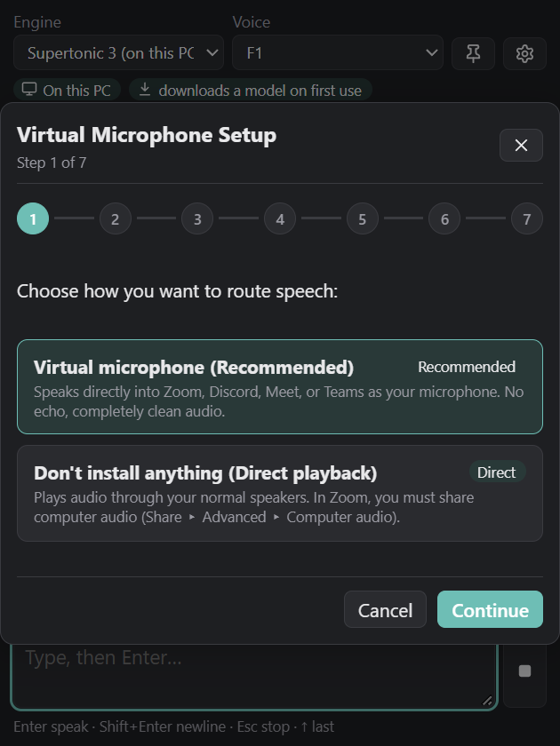

# soritong (소리통)

Type Korean or English, press Enter, and soritong speaks it as your microphone in Zoom, Google
Meet, Teams or Discord. You can join a call without saying a word aloud.


It was made for a monthly Korean book club on Zoom, which meets at 4-5 am for one member while
the rest of the family is asleep. Speech feels more personal to the other members than chat text.

[한국어 README](README.ko.md)

## Download

Get the latest build from [Releases](https://github.com/shyoo/soritong/releases) (Windows 10/11, x64):

- **`soritong-<version>-windows-x64-setup.exe`**: the installer. It installs for your user
  account only, so it needs no administrator rights, and adds a Start menu entry and an uninstaller.
- **`soritong-<version>-windows-x64-portable.zip`**: unzip it anywhere and run `soritong.exe`.

`SHA256SUMS.txt` lists the checksums of both files. The builds aren't code-signed yet, so
Windows SmartScreen may warn on first run. Choose **More info**, then **Run anyway**.

## How it works

Zoom only reads sound from a recording device. Windows apps can't create one without a driver, so
soritong uses the free [VB-CABLE](https://vb-audio.com/Cable/) virtual cable. soritong plays
speech into the cable's input, and Zoom uses the cable's output as your microphone:

```
 you type ──> soritong ──> TTS voice ──┬──> CABLE Input ══> CABLE Output ──> Zoom (microphone)
                                       └──> your headphones (optional, to hear yourself)
```

Only soritong writes into the cable, so the people in the meeting never hear their own voices
echoed back.

### Setup wizard

On first start, a wizard does the setup for you:



1. It downloads the official VB-CABLE installer (checksum pinned) and starts it. Windows
   asks for administrator rights for the driver.
2. It puts your speakers and microphone back to the defaults you had before, because VB-CABLE
   sometimes takes them over.
3. It points soritong at `CABLE Input`.
4. It plays a test tone through the cable, to prove the sound arrives before you join a call.
5. It shows exactly what to pick in Zoom, with a button to copy the microphone name.

The wizard can be reopened from Settings at any time.

**No-install option:** pick "Don't install anything" in the wizard. soritong then plays through
your normal speakers, and in Zoom you share sound with **Share > Advanced > Computer audio**. It
needs no driver, but any other sound on your PC is shared too, and you have to start it in
each meeting.

## Voices

| Engine | Where it runs | Notes |
| :--- | :--- | :--- |
| **Supertonic 3** | On this PC | Free and private: no text leaves the PC. Korean and English. The ~400 MB model downloads on first use. Runs on the CPU. |
| **Microsoft Edge voices** | Online | Free, no key, natural Korean and English. Uses the same unofficial service as Edge's Read Aloud, so it may break or be rate-limited. |
| **ElevenLabs** | Online | Your own [voice clone](https://elevenlabs.io/voice-cloning) or any ElevenLabs voice. Needs your API key; uses your credits. Replays come from a local cache and cost nothing. |
| **OpenAI-compatible** | Online or local | OpenAI's `/v1/audio/speech`, or a local server that speaks the same API (e.g. a voice-cloning model running on your own GPU). |
| **Windows built-in voices** | On this PC | No setup, but robotic. Korean needs the Korean language with its text-to-speech feature installed in Windows Settings. |

API keys are kept in Windows Credential Manager, never in a file.

## Using it

- **Enter** speaks the text. **Shift+Enter** adds a new line. **Esc** stops speaking. **Up arrow** brings back the last message.
- **Ctrl+Alt+Space** brings soritong to the front from inside Zoom.
- Click a quick phrase (네, 맞아요 / 잠시만요 / ...) to say it at once. Use the pencil to edit them.
- Use the play button next to a message to say it again.
- The headphones button sends a copy to your headphones, so you hear what the meeting hears.

### In Zoom

1. **Settings > Audio > Microphone**: `CABLE Output (VB-Audio Virtual Cable)`.
2. Leave **Speaker** on your headphones.
3. Turn off **Automatically adjust microphone volume**. If speech sounds choppy, set
   **Suppress background noise** to **Low**.

Google Meet, Teams and Discord work the same way: choose `CABLE Output (VB-Audio Virtual Cable)`
as the microphone.

## Where things are kept

- Settings: `%APPDATA%\soritong\settings.json`
- Voice model and speech cache: `%LOCALAPPDATA%\soritong`

Uninstalling leaves both folders, so a reinstall keeps your settings. Delete them to remove
everything. VB-CABLE is uninstalled separately, with its own setup program.

## Building from source

You need Rust (stable, 1.85 or newer), Node.js 22 and the Visual Studio C++ build tools.

```powershell
git clone https://github.com/shyoo/soritong.git
cd soritong
cargo test --workspace
cargo run -p soritong-app                 # the app
cargo run -p soritong-cli -- --help       # a command-line speaker, for testing engines
pwsh -File scripts/release.ps1            # installer + portable ZIP in dist/ (needs tauri-cli)
```

[AGENTS.md](AGENTS.md) covers how the code is organised and the checks to run, and
[docs/PLAN.md](docs/PLAN.md) records the design and the options considered.

## Licence

Apache-2.0, see [LICENSE](LICENSE). The Supertonic 3 model weights are not part of this repository.
They are downloaded from Supertone under the BigScience OpenRAIL-M licence, which restricts harmful
uses. VB-CABLE is donationware by
VB-Audio and is downloaded from them, not bundled. See [THIRD_PARTY_NOTICES.md](THIRD_PARTY_NOTICES.md).
